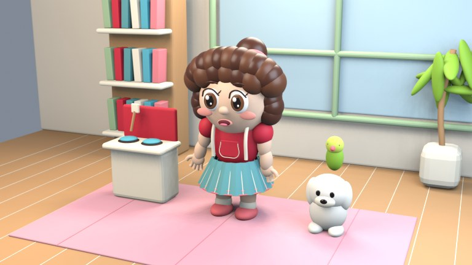

# 태산이 애니메이션 CPU 실험실

## 최신 실험: 연결된 얼굴 메시 + 한국어 말하기

[**새 영상**](results/009-connected-korean.mp4) · [이전/이후 비교](results/008-before-after.jpg) · [검수·측정](results/009-connected-speech.md)

머리와 눈꺼풀을 하나의 연결된 메시로 다시 만들고 눈을 안쪽으로 배치했다. 볼 경계선과 닫힌 눈의 눈동자 노출은 줄었지만, 눈 주변 굴곡과 단순한 입 구조가 남아 있다. CPU 렌더 241.43초, 576×576 / 24fps / 77프레임. 입 모양 전환의 수치 개선은 작으며 **원본과 동일한 품질이나 통합 제작 웹페이지 완성을 뜻하지 않는다.**

## 이전 실험: 얼굴 피부 리그 + 한국어 말하기

[**새 말하기 영상**](results/007-skin-rig-korean.mp4) · [프레임 비교](results/007-speech-frames.jpg) · [검수 기록](results/007-skin-rig-speech.md) · [얼굴 포즈 비교](results/006-poses.jpg)

눈꺼풀·턱·입술을 얼굴 메시의 shape key로 변형하고 기존 한국어 음성에 연결했다. CPU 렌더 225.51초, 576×576 / 24fps / 77프레임. 눈꺼풀 돌출·얼굴 이음새·거친 입 모양이 남아 있으며 **똘똘이와 동일한 외형·품질에 도달하지 못했다.** 통합 제작 웹페이지도 아직 완성되지 않았다.

## 이전: 얼굴·머리 수정 + 실제 한국어 말하기

[**한국어 말하기 영상**](results/005-korean-talking-B.mp4) · [얼굴 A/B/C 비교](results/004-variants.jpg) · [실험 기록](results/004-likeness-and-speech.md)

Blender EEVEE / Mesa llvmpipe / Supertonic 3 / Rhubarb / faster-whisper를 CPU에서 실제 연결·검증했다. 한국어 대사와 입 모양 15구간, 77프레임, 768×432 영상. 독립 받아쓰기는 문장부호·공백 제외 입력과 일치했다. 원본과 동일한 외형·목소리·연기 또는 자동 다음 편 제작 완성도는 아니다.

프롬프트 기반 애니메이션 제작툴을 위한 공개 실험 저장소입니다. 첫 실험은 **Blender Cycles CPU 렌더링**입니다. 외부 생성 API나 GPU 없이 자체 제작한 절차형 캐릭터를 움직입니다.

## 실행하기

1. 저장소 **Actions → CPU Animation Lab → Run workflow**를 누릅니다.
2. 프롬프트에 `태산이가 손을 흔들며 인사한다`, `태산이가 깜짝 놀란다`, `태산이가 고개를 둘러본다` 중 하나를 입력합니다.
3. 완료된 실행의 **Artifacts**에서 `taesan-cpu-experiment-*` ZIP을 받습니다.
4. `taesan-cpu.mp4`를 재생하고 `report.json`과 `resource.txt`에서 실행 시간과 메모리를 확인합니다.

## 현재 프리뷰 사양

| 항목 | 설정 |
|---|---|
| 렌더러 | Blender Cycles CPU |
| 영상 | 320×180 / 16fps / 96프레임 / 6초 |
| 동작 | 손 흔들기 또는 놀람 또는 둘러보기, 눈 깜빡임, 호흡 |
| 샘플 | 2 samples, 디노이징 끔; 노이즈 많은 빠른 프리뷰 |
| 촬영 | 세 개 카메라 구도 |
| 결과 | H.264 MP4, PNG 프레임, 원본 scene.blend, 자원 기록 |
| 실행 제한 | 25분, 동시 실행 1개 |
| 산출물 보관 | Actions 아티팩트 14일 |

## 현재 한계

초기 CPU Animation Lab은 키워드를 정해진 동작에 연결합니다. 별도 studies 실험에서 고정 한국어 음성과 음소 기반 입 모양을 연결했습니다. 임의의 이야기 이해·자동 대본·두 인물의 상호작용과 통합 제작 웹페이지는 아직 없습니다. 기존 방송 캐릭터나 자산은 사용하지 않습니다. 단순한 실험용 모델이며 방송 애니메이션 수준의 품질을 달성했다고 주장하지 않습니다. 모델 추론 기반 영상 생성 성능을 측정하는 실험도 아닙니다.

작업 입력은 셸 코드로 실행하지 않으며 GitHub Secrets가 필요 없습니다. 자동 재귀 실행, 채굴, 원격 데스크톱, 상시 서버가 없는 유한한 렌더 작업입니다.

상세: [실험 기준](EXPERIMENTS.md) · [범위](LAB.md)

## 실제 실험 결과

- [001: 검은 프레임으로 시각 검증 실패](results/001-baseline.md)
- [002: 6초 CPU 프리뷰 실제 출력 확인](results/002-preview.md) — 렌더 29.35초, 최대 RSS 약 237.4 MiB. [성공 실행과 영상 아티팩트](https://github.com/quddnr0107-lgtm/taesan-animation-lab/actions/runs/40147203271)

두 실험은 해상도·샘플·설정이 달라 동일 조건 속도 비교가 아닙니다. 첫 프레임 밝기·명암 검사를 통과해야 전체 렌더를 진행합니다. 이후 실행은 수동으로만 시작합니다.

## 똘똘이 참고 장면 재현 실험

[**3초 결과 영상 MP4**](results/003-reference-study.mp4) · [실험 기록과 원본 대비 차이](results/003-reference-study.md)

CPU llvmpipe 소프트웨어 렌더러로 768×432 / 24fps / 72프레임 출력을 검증했다. 대표 이미지 포함 렌더 241.43초. 이전 단순 시제품보다 세밀한 얼굴·손·의상·실내·동물을 구현했으나 원본과 동일하지 않다. 음성·음소 립싱크 없음.

Actions → **Preschool Reference Study** → Run workflow. 대표 프레임만 먼저 검사 옵션을 끄면 3초 영상을 출력한다.
