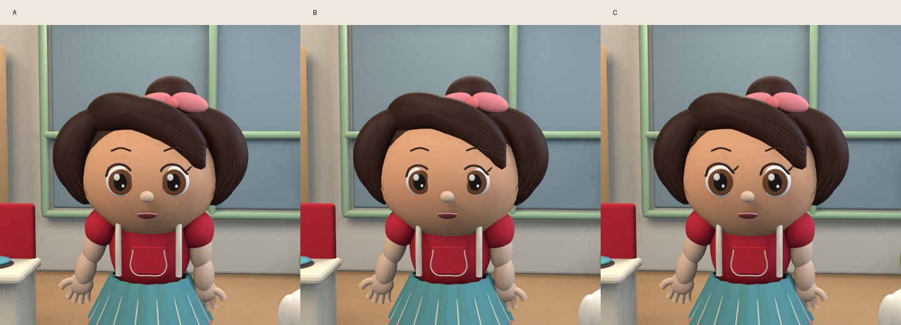

# 실험 004 — 얼굴·머리 변형과 CPU 한국어 도구 접목

## 실행과 결과

- 얼굴·음성 도구 묶음: https://github.com/quddnr0107-lgtm/taesan-animation-lab/actions/runs/40149489339 — 네 작업 모두 성공
- A: 640×640 대표 프레임 25.27초
- B: 640×640 대표 프레임 14.66초
- C: 640×640 대표 프레임 14.51초

모든 안은 같은 카메라와 조명 아래에서 비교했다. 실행 시간이 다른 것은 러너·시작 비용도 포함하므로 안별 성능 우열로 해석하지 않는다.

변경: 연속 테이퍼 메쉬 머리카락, 눈 깊이 축소, 홍채·흰자 비율, 볼·턱 실루엣, 얼굴 버텍스 색으로 섞은 볼터치, 옷감 요철과 반사 감소. 단순한 이미지 필터가 아니라 실제 3D 장면 모델을 변경했다.

시각 검토: 구슬 같은 머리와 떠 있는 볼터치는 줄었다. 여전히 원본의 머리카락 파동, 눈꺼풀과 얼굴 곡면, 의상·손의 변형, 연기와 다르다. B는 돌출된 눈을 줄인 기준 모델로 음성 연결을 검증한다. 원본과 가장 닮았다는 객관적 점수는 산출하지 않았다.

## 실제 도입한 공개 도구

- **Supertonic 3 ONNX CPU**: 한국어 F1·F4 프리셋 2개 생성
- **Rhubarb 1.14.0 phonetic**: F1 음성에서 입 모양 15구간 추출
- 음성 길이 3.1744375초 / 16kHz / RMS 0.04916
- 합성·분석 단계 12.06초 (설치·모델 다운로드 시간은 제외)
- 고정 모델 revision과 공식 자산 해시: [실험 출처 기록](../studies/fixtures/004-provenance.json)
- [실제 한국어 WAV](../studies/fixtures/004-voice.wav), [입 모양 구간 JSON](../studies/fixtures/004-mouth-cues.json)

**원본 성우의 목소리나 어린이 음성을 복제하지 않았다.** 일반 프리셋 음성이다. Rhubarb의 언어 독립 phonetic 추정은 정확한 한국어 음소 정렬과 다르다.

## 독립 받아쓰기 검사

실행: https://github.com/quddnr0107-lgtm/taesan-animation-lab/actions/runs/40149820789

faster-whisper small, CPU int8. 기대 대본을 초기 프롬프트로 넣지 않았다.

- 입력: `안녕! 오늘은 무슨 놀이를 할까?`
- 받아쓰기: `안녕. 오늘은 무슨 놀이를 할까?`
- 공백·문장부호 제외 글자 오류율: 0.0
- 로딩·받아쓰기: 7.56초

첫 검사에서 requests 의존 패키지 누락으로 실패했으며, 버전과 패키지를 보완해 검사만 별도 재실행했다. 받아쓰기 일치는 억양·감정·성우 유사성을 보장하지 않는다.

## 음성 연결 영상

실행: https://github.com/quddnr0107-lgtm/taesan-animation-lab/actions/runs/40149758694

B 모델의 입 모양에 실제 구간 JSON을 연결하고, 한국어 WAV와 AAC 오디오가 포함된 H.264 영상을 검사한다. 원래 실행의 받아쓰기 작업은 설치 결함으로 실패했으므로 전체 workflow 상태와 렌더 작업의 상태를 구분한다. 수정된 받아쓰기 검사는 위 별도 실행에서 통과했다. 영상 결과와 실측 시간은 완료 후 추가한다.
